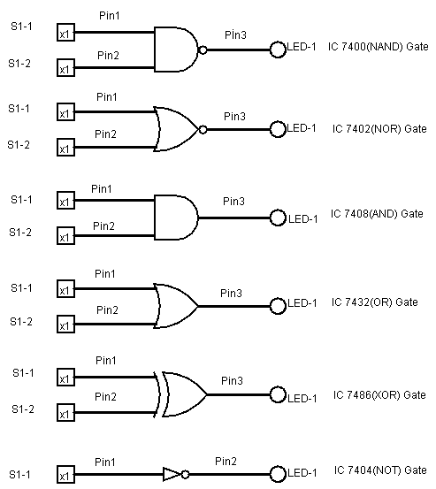
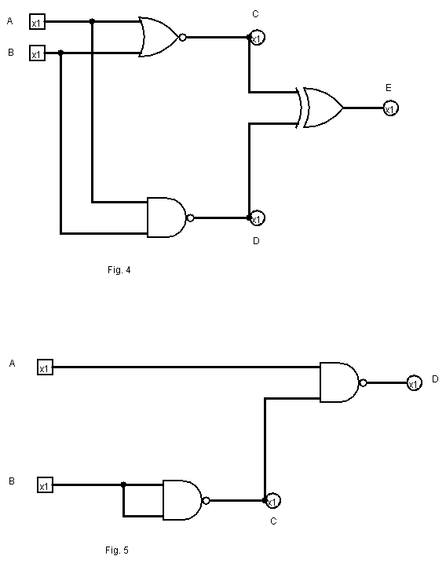
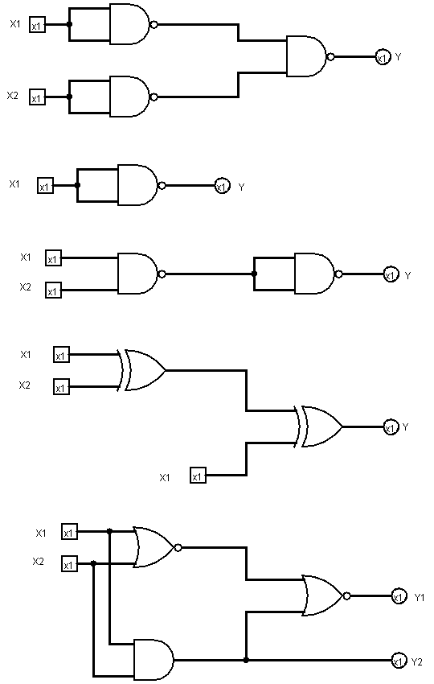

# Lab 1: Temel Mantık Kapıları

Temel mantık kapılarının (AND, OR, NOT, NAND, NOR, XOR) doğruluk tabloları, tepkileri ve Boolean ifadeleri Logisim ile incelenmiştir. NAND ve NOR gibi evrensel kapıların farklı fonksiyonları türetmedeki esnekliği gözlemlenmiştir.

## 📂 Devreler ve İçerikler

| Dosya | Açıklama |
|-------|----------|
| `Lab1-Part1-Logic-Gates.circ` | 7400 (NAND), 7402 (NOR), 7408 (AND), 7432 (OR), 7486 (XOR) ve 7404 (NOT) kapılarının anahtar ve LED ile doğruluk tablosu gözlemi. |
| `Lab1-Part2-Response-of-Logic-Gates.circ` | Fig. 4 (A ve B'nin NOR ve NAND çıkışlarının XOR'lanması) ve Fig. 5 (B girişinin terslenmesi ile NAND lojiği). |
| `Lab1-Part3-Review-Questions.circ` | NAND kapılarıyla OR, NOT ve AND kapılarının gerçeklenmesi, XOR sadeleştirmeleri ve yarım toplayıcı devresi. |

## 📸 Ekran Görüntüleri

### Part 1: Temel Mantık Kapıları

### Part 2: Kapı Tepkileri (Fig. 4 & Fig. 5)

### Part 3: İnceleme Soruları ve Dönüşümler
