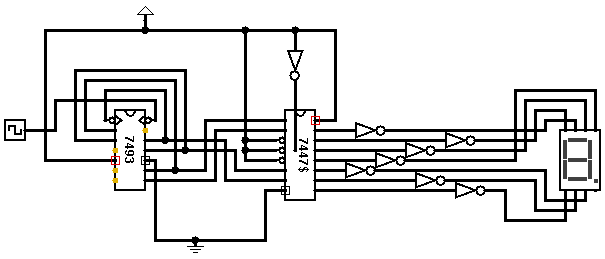

# Lab 2: BCD Sayaç ve BCD-to-7 Segment Dekoder

7493 asenkron (ripple) sayaç çıkışları 7447 BCD-to-7 Segment Dekodere bağlanarak 0-9 aralığında BCD sayma işlemi gerçekleştirilmiş ve 7-segment display üzerinde gözlemlenmiştir.

| Dosya | Açıklama |
|-------|----------|
| `Lab2-Procedure2-BCD-Counter-7-Segment.circ` | 7493 çıkışları 7447'ye bağlanmış ve reset pinleri (R1, R2) ile 0-9 arasında döngü sağlanmıştır. |

**Tasarım Notu:** 7447 entegresinin çıkışları Common Anode displayler için aktif-düşüktür (active-low). Logisim'deki display ile doğrudan uyum sağlaması için çıkışlara NOT kapıları eklenmiştir.

> **Kütüphane Bağımlılığı:** Devrenin çalışabilmesi için `74TTLs_1.03.circ` ve `7-segment-display-driver.circ` dosyalarının proje ile aynı dizinde bulunması gerekmektedir.

## 📸 Devre Görseli

