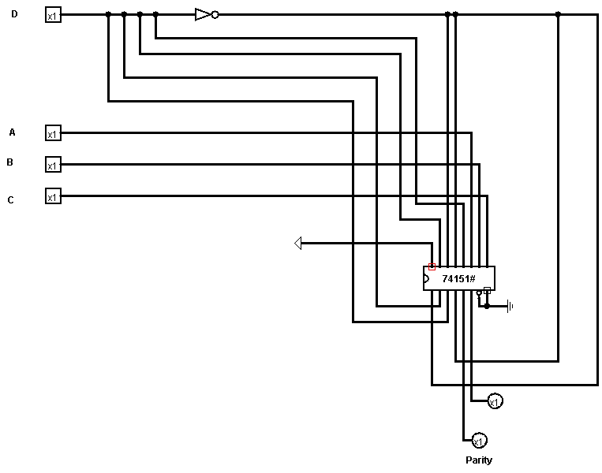
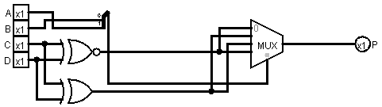
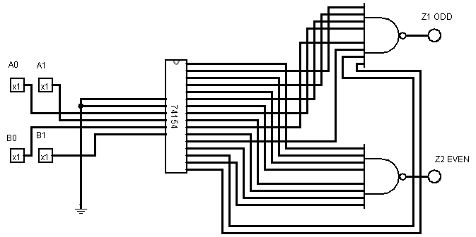
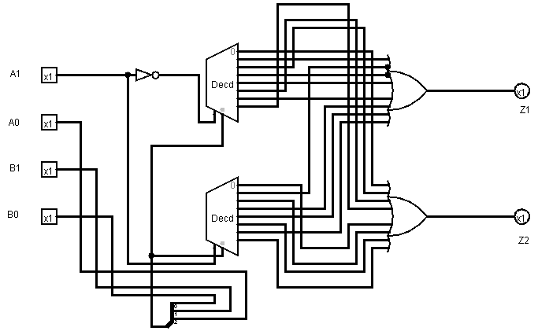

# Lab 3: Kombinasyonel Devre Tasarımı ve Çoklayıcılar

Bu laboratuvarda çoklayıcılar (Multiplexer - MUX) ve dekoderler kullanılarak kombinasyonel mantık devreleri ve parity (eşlik) üreticileri tasarlanmıştır.

## 📂 Devreler ve İçerikler

| Dosya | Açıklama |
|-------|----------|
| `Lab3-PreLab-Q1-Odd-Parity-Generator.circ` | Tek eşlik (Odd Parity) üreteci devresi. |
| `Lab3-PreLab-Q2-Parity-Generator-Mux.circ` | MUX kullanılarak gerçeklenen eşlik üreticisi. |
| `Lab3-PreLab-Q3-Even-Odd-Sum-74154-NAND.circ` | 74154 dekoder ve NAND kapıları ile çift/tek toplam ve fonksiyon tasarımı. |
| `Lab3-PreLab-Q4-Even-Odd-Sum-3to8-Decoders.circ` | 3'ten 8'e dekoderler kullanılarak tasarlanan çift/tek toplam devresi. |

> **Kütüphane Bağımlılığı:** Devrelerin çalışabilmesi için `74TTLs_1.03.circ` kütüphane dosyasının proje ile aynı dizinde bulunması gerekmektedir.

## 📸 Ekran Görüntüleri

### Eşlik Üreteci (Odd Parity Generator)

### MUX ile Parity Üreteci

### 74154 Dekoder ve NAND Devresi

### 3'ten 8'e Dekoderler ile Toplam Devresi
