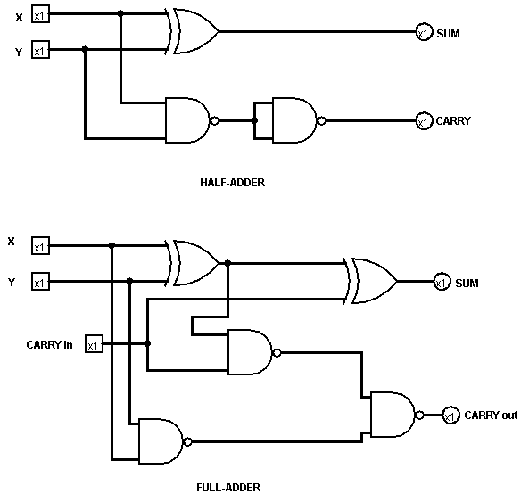
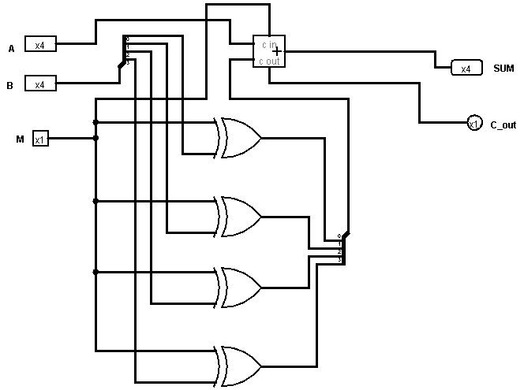

# Lab 4: Toplayıcılar ve Çıkarıcılar (Adders & Subtractors)

Bu laboratuvarda işaretli ikili sayılar (1'e ve 2'ye tümleyen) üzerinde çalışılmış, 4-bit toplama ve çıkarma işlemleri gerçekleştiren donanım tasarımları Logisim üzerinde simüle edilmiştir.

## 📂 Devreler ve İçerikleri

| Dosya | Açıklama |
|-------|----------|
| `Half-and-Full-Adder.circ` | Yalnızca XOR ve NAND kapıları kullanılarak tasarlanmış Half-Adder ve Full-Adder devreleri. |
| `4-Bit-Adder-Subtractor.circ` | 4-bit toplayıcı modülü ve XOR kapıları ile tasarlanmış seçmeli toplama/çıkarma devresi. |

### 1. Yarı ve Tam Toplayıcı (Half & Full Adder)
Devrede AND-OR kapı mantığı yerine, donanım optimizasyonu sağlamak amacıyla tamamen **NAND** kapıları kullanılarak eşdeğer tasarım yapılmıştır.

### 2. 4-Bit Toplayıcı / Çıkarıcı (Adder-Subtractor)
Seçici uç (M pini) ile devrenin toplama veya çıkarma yapması kontrol edilir.

* **Toplama (M = 0):** XOR kapıları B girişini aynen geçirir. M, Carry-In'e 0 olarak gider. Devre **A + B** işlemini yapar.
* **Çıkarma (M = 1):** XOR kapıları B girişini ters çevirir (1'e tümleyen). M sinyali Carry-In'e 1 olarak gittiği için devre B'nin 2'ye tümleyenini alır. Devre **A - B** işlemini yapar.

> ⚠️ **Taşma (Overflow) Notu:** 4 bitlik işaretli sayı aralığı **-8 ile +7** arasındadır. Yapılan işlemin sonucu bu aralığın dışına çıkarsa (Örneğin: `6 + 7 = 13`) taşma (overflow) bayrağı oluşur ve sonuç hatalı değerlendirilir.