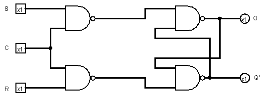
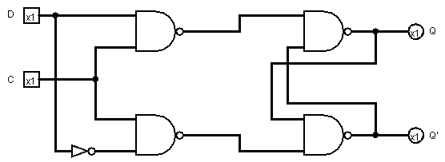
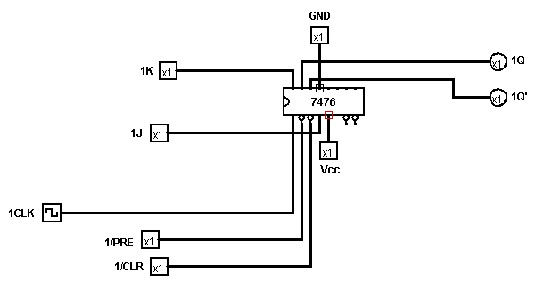
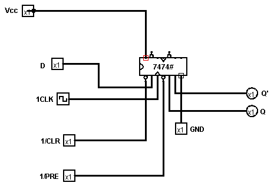

# Lab 5: Flip-Flop ve Latch Devreleri

Bu laboratuvarda NAND kapılarıyla kurulan temel bellek elemanlarından (latch) başlayarak, MSI seviyesindeki JK ve D flip-flop entegrelerinin çalışması ve tetiklenme karakteristikleri incelenmiştir.

## 📂 Devreler ve İçerikleri

| Dosya | Açıklama |
|-------|----------|
| `Lab5-Procedure1-SR-Latch.circ` | NAND kapılarıyla kapılı (gated) SR latch. C=1 iken S ve R'ye tepki verir. S=R=1 girişleri yasak durumdur. |
| `Lab5-Procedure2-D-Latch.circ` | SR latch devresine NOT kapısı eklenerek oluşturulmuş D latch. E=1 iken saydam (transparent), E=0 iken önceki durumu tutar. |
| `Lab5-Procedure3-JK-Flip-Flop-7476.circ` | 7476 JK master-slave flip-flop. PRE ve CLR girişleri aktif-düşüktür (active-low), normal çalışmada ikisi de 1 olmalıdır. |
| `Lab5-Procedure4-D-Flip-Flop-7474.circ` | 7474 pozitif kenar tetiklemeli D flip-flop. Asenkron set/reset ve senkron çalışma modları içerir. |

> **Kütüphane Bağımlılığı:** 7476 ve 7474 entegrelerini içeren devrelerin çalışabilmesi için `74TTLs_1.03.circ` kütüphane dosyasının projelerle aynı dizinde (`Lab5` klasöründe) bulunması gerekmektedir.

## 📸 Ekran Görüntüleri

### SR Latch (Kapılı - Gated)

### D Latch

### 7476 JK Flip-Flop (Master-Slave)

### 7474 D Flip-Flop (Pozitif Kenar Tetiklemeli)
