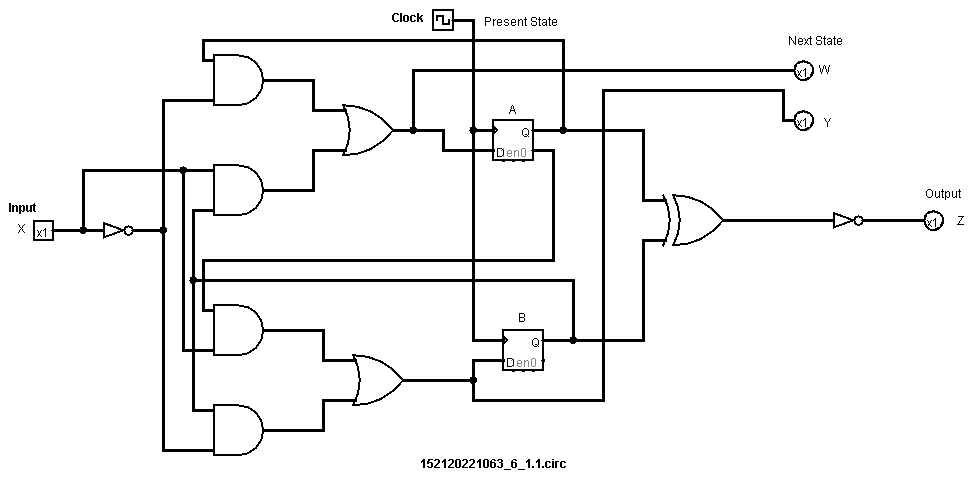
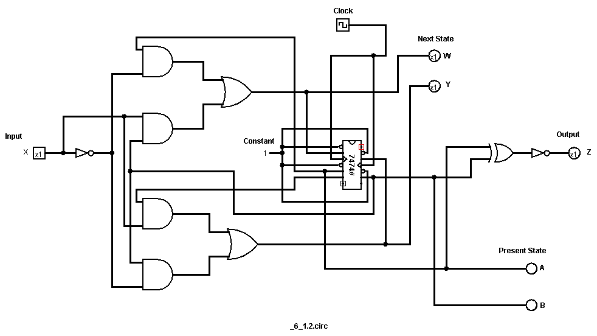

# Lab 6: Senkron Ardışıl Devreler (Synchronous Sequential Circuits)

Bu laboratuvarda bir giriş (x) ve bir çıkışı (z) olan senkron durum makinesi (state machine) tasarımı gerçekleştirilmiştir. 

* **x = 1** iken devre `00 → 01 → 11 → 10 → 00` dizisinde ilerler.
* **x = 0** iken devre mevcut durumunu korur.
* **Çıkış (z)**, yalnızca mevcut durum `00` veya `11` ise `1` olur. Çıkış yalnızca mevcut duruma bağlı olduğu için devre bir **Moore makinesidir**.

**Türetilen Durum Denklemleri:**
* D1 = x'·Q1 + x·Q0
* D0 = x'·Q0 + x·Q1'
* z = (Q1 ⊕ Q0)'

## 📂 Devreler ve İçerikleri

| Dosya | Açıklama |
|-------|----------|
| `Lab6-Procedure1-State-Machine-D-FF.circ` | Standart D flip-flop ve temel mantık kapılarıyla kurulan durum makinesi. |
| `Lab6-Procedure2-State-Machine-7474.circ` | Aynı tasarımın 7474 D Flip-Flop entegresi kullanılarak gerçeklenmiş hali. LED'ler mevcut (A, B) ve sonraki (W, Y) durum çıkışlarını gösterir. |

> **Kütüphane Bağımlılığı:** 7474 entegresini içeren devrenin çalışabilmesi için `74TTLs_1.03.circ` kütüphane dosyasının projeyle aynı dizinde bulunması gerekmektedir.

## 📸 Ekran Görüntüleri

### Temel D Flip-Flop ile Durum Makinesi

### 7474 Entegresi ile Durum Makinesi
