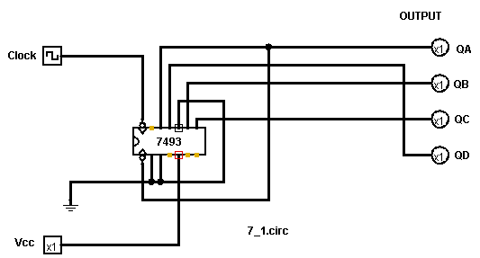
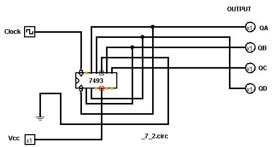
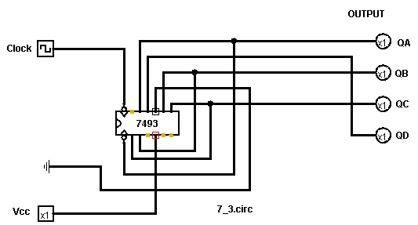
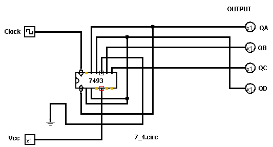
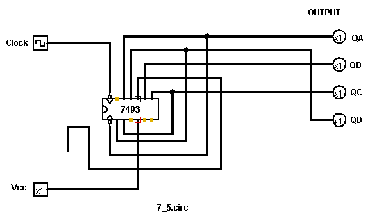

# Lab 7: İkili ve Ondalık Sayaçlar (Binary & BCD Counters)

Bu laboratuvarda **7493 4-bit Asenkron (Ripple) Sayaç** entegresi kullanılarak farklı modlarda (MOD-16, MOD-10, MOD-6, vb.) sayma dizileri tasarlanmış ve Logisim'in Timing Diagram (Zamanlama Diyagramı) özelliği ile incelenmiştir.

**Çalışma Mantığı:** 
7493 entegresinin `R1` ve `R2` reset girişleri aynı anda `1` (High) olduğunda sayaç asenkron olarak `0000` durumuna döner. Sayaç belirli bir aralıkta tutulmak istendiğinde, hedeflenen son değerden bir sonraki durumu (istenmeyen ilk durum) yakalayan çıkış pinleri bu reset girişlerine bağlanır.

## 📂 Devreler ve İçerikleri

| Dosya | Açıklama | Reset Bağlantısı |
|-------|----------|------------------|
| `Lab7-BinaryCount-Binary-Counter-7493.circ` | 0-15 İkili Sayaç (MOD-16) | Reset bağlantısı yok (R1 ve R2 Toprakta) |
| `Lab7-BCDCount-BCD-Counter-7493.circ` | 0-9 BCD Sayaç (MOD-10) | R1 = QB, R2 = QD (1010'da sıfırlar) |
| `Lab7-OtherCounts-A-Counter-0-to-5.circ` | 0-5 Sayaç (MOD-6) | R1 = QB, R2 = QC (0110'da sıfırlar) |
| `Lab7-OtherCounts-B-Counter-0-to-7.circ` | 0-7 Sayaç (MOD-8) | R1 = R2 = QD (1000'de sıfırlar) |
| `Lab7-OtherCounts-C-Counter-0-to-11.circ` | 0-11 Sayaç (MOD-12) | R1 = QC, R2 = QD (1100'de sıfırlar) |

> **Kütüphane Bağımlılığı:** Tüm devrelerin çalışabilmesi için `74TTLs_1.03.circ` kütüphane dosyasının projelerle aynı dizinde bulunması gerekmektedir.

## 📸 Ekran Görüntüleri

### İkili Sayaç (0-15)

### BCD Sayaç (0-9)

### MOD-6 Sayaç (0-5)

### MOD-8 Sayaç (0-7)

### MOD-12 Sayaç (0-11)
